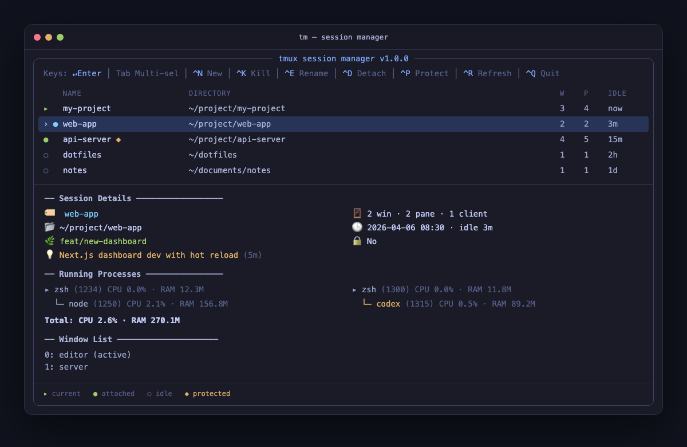

<div align="center">

# tm — tmux Session Manager

**Maintain Claude Code sessions across devices using tmux.**

**Pure Bash + fzf. Single file. Zero friction. Millisecond startup.**

[](LICENSE)
[](#dependencies)
[](#platform-support)

[繁體中文](README.zh-TW.md)

</div>

> **Why tm?** Modern development means running multiple AI agents, Claude Code sessions, and background tasks across tmux — often on a remote server you want to reach from any device. `tm` gives you instant visibility into what's running where, with process trees, AI-powered summaries, and protection locks to keep critical sessions safe. Start a Claude Code session on your desktop, detach, then SSH into the same remote host from your laptop or phone and pick up exactly where you left off. On mobile (iOS / Android), just SSH into your remote server and run `tm` — the fzf interface works great with touch, letting you manage sessions on the go.

---

## Demo



```
╭──────────────── tmux session manager v1.0.0 ──────────────────╮
│ Keys: ↵Enter │ Tab Multi-sel │ ^N New │ ^K Kill │ ^P Protect  │
│                                                               │
│      NAME                  DIRECTORY                W  P IDLE │
│  [▸] my-project            ~/project/my-project     3  4 now  │
│ >[●] web-app               ~/project/web-app        2  2 3m   │
│  [●] api-server 🔒         ~/project/api-server     4  5 15m  │
│  [○] dotfiles              ~/dotfiles               1  1 2h   │
│  [○] notes                 ~/documents/notes        1  1 1d   │
│                                                               │
│╭─────────────────────────────────────────────────────────────╮│
││ ── Session Details ──────────────────                       ││
││ 🏷️  web-app                                                 ││
││ 📂 ~/project/web-app                                        ││
││ 🌿 feat/new-dashboard                                       ││
││ 🪟 2 win · 2 pane · 1 client                                ││
││ 🕒 2026-04-06 08:30 · idle 3m                               ││
││ 💡 Next.js dashboard dev with hot reload                    ││
││                                                             ││
││ ── Running Processes ────────────────                       ││
││   ▸ zsh  (1234)  CPU 0.0% · RAM 12.3M                       ││
││     └─ node  (1250)  CPU 2.1% · RAM 156.8M                  ││
││   ▸ zsh  (1300)  CPU 0.0% · RAM 11.8M                       ││
││     └─ claude  (1315)  CPU 0.5% · RAM 89.2M                 ││
││   Total: CPU 2.6% · RAM 270.1M                              ││
││                                                             ││
││ ── Window List ─────────────────────                        ││
││   0: editor (active)                                        ││
││   1: server                                                 ││
│╰─────────────────────────────────────────────────────────────╯│
╰───────────────────────────────────────────────────────────────╯

Status indicators:  [▸] current   [●] attached   [○] idle   🔒 protected
```

---

## Highlights

| | Feature | Description |
|---|---|---|
| 🤖 | **AI Summaries** | Auto-generate session purpose summaries with Claude Haiku |
| 💾 | **Backup & Restore** | Snapshot sessions with Claude Code and Codex state, restore after reboot |
| 🌳 | **Process Tree** | See every pane's shell and child processes with CPU/RAM |
| 🔒 | **Protection Lock** | Prevent critical sessions from accidental termination |
| ⚡ | **Smart Sorting** | Most recently used sessions always on top |
| 🎨 | **Group Colors** | Sessions in the same directory share indicator colors |
| 🌿 | **Git Branch** | Preview panel shows current branch at a glance |
| 📋 | **Session Templates** | Create multi-window layouts in one command |
| 💀 | **Batch Kill** | Multi-select and kill with three-stage safety confirmation |

---

## Quick Start

```bash
git clone <repo-url> && cd session-manager
./install-fzf.sh
chmod +x tm.sh
./tm.sh
```

## Installation

```bash
# Clone or download to any directory
chmod +x tm.sh

# Download fzf (required for interactive mode)
./install-fzf.sh

# (Optional) Create a global shortcut — pick one:
ln -sf "$(pwd)/tm.sh" ~/.local/bin/tm
# or add to ~/.bashrc / ~/.zshrc:
alias tm="~/session-manager/tm.sh"
```

### Dependencies

| Tool | Version | Purpose | Install |
|------|---------|---------|---------|
| `bash` | 4.0+ | Required | See note below |
| `tmux` | — | Required | `brew install tmux` / `apt install tmux` |
| `fzf` | — | Interactive mode | Run `./install-fzf.sh` to auto-download into the project directory |

> [!NOTE]
> CLI mode (`ls`, `kill`, `protect`, etc.) only requires tmux — no fzf needed.

> [!WARNING]
> **macOS users:** The default `/bin/bash` is version 3.2. You need bash 4.0+ for this tool to work. Install a newer version with `brew install bash` and make sure the new bash is in your `$PATH` before `/bin/bash`.

### Platform Support

Works on desktop and mobile — attach to the same remote tmux sessions from anywhere, so your Claude Code work follows you across devices.

| Platform | How to use |
|----------|------------|
| **macOS** (ARM / Intel) | Run directly, or SSH into a remote host |
| **Linux** (amd64 / arm64) | Run directly, or SSH into a remote host |
| **iOS / iPadOS** | SSH into your remote server via [Termius](https://termius.com/) |
| **Android** | SSH into your remote server via [Termux](https://termux.dev/) |

> [!TIP]
> On mobile, `tm`'s fzf-based UI works great with touch and on-screen keyboards — no desktop required. Pair with mosh for a seamless experience over unstable remote connections.

---

## Usage

### Interactive Mode (Recommended)

```bash
./tm.sh          # Launch fzf interactive menu
```

| Shortcut  | Action                              |
|-----------|-------------------------------------|
| `Enter`   | Attach to selected session (on a group row: fold/unfold) |
| `←` / `→` | Fold / unfold the group (moves the cursor while you type a query) |
| `Ctrl-G`  | Put selected sessions in a group (empty name: back to directory groups) |
| `Tab`     | Multi-select (for batch kill with `Ctrl-K`) |
| `Ctrl-N`  | Create new session                  |
| `Ctrl-K`  | Kill session (supports multi-select batch kill); on a parked row: forget it |
| `Ctrl-X`  | Park: close the session but keep its row; `Enter` on the row resumes its Claude agents |
| `Ctrl-E`  | Rename session                      |
| `Ctrl-D`  | Detach other clients                |
| `Ctrl-P`  | Toggle protection lock 🔒           |
| `Ctrl-R`  | Refresh list                        |
| `Ctrl-Q`  | Quit                                |
| `Esc`     | Quit                                |

#### Session groups

- Sessions in the same directory are grouped under a `▾ <dir>:` row; worktrees under `.claude/worktrees/` or `.worktrees/` count as their repo. A directory with a single session is not grouped.
- `Ctrl-G` or `tm group <name> <session>...` puts sessions in a group of your own, which overrides the directory; a group you name shows even with one session. An empty name (or `tm group --clear`) returns them to their directory group. Renaming a session keeps its group.
- A group row shows state counts such as `❓1 ⏳2 💤3 (6)`. A folded group (`▸`) also lists its session names, so a query still finds it.
- Groups with a blocked agent float to the top like sessions do; inside a group the blocked sessions lead.
- Manual groups live in `~/.tmux-manager/groups.tsv`, folded groups in `~/.tmux-manager/folded.txt`. Set `TM_GROUPS=off` for the flat list.

#### Parking sessions

- `Ctrl-X` (or `tm park <name>`) closes a session that runs Claude agents but keeps a `⏸ parked` row. It records each agent's conversation ID and directory in `~/.tmux-manager/parked/` (owner-only).
- `Enter` on the row (or `tm revive <name>`) recreates the session with one window per agent in its directory, each running `claude --resume <id> --dangerously-skip-permissions` (the same flags as `tm restore --claude`; `TM_CLAUDE_CMD` changes the command).
- Parking asks `y` when every agent is idle; when one is working or waiting, its current turn would be lost, so you type the session name. Protected and current sessions cannot be parked, and a session without a Claude agent is closed with `Ctrl-K` instead.
- Only Claude panes come back; use `tm save` and `tm restore` to keep a full layout. A live session with the same name hides the parked row, and reviving refuses until the name is free.
- `Ctrl-K` on a parked row forgets it; the conversations stay in Claude's history. The preview of a parked row shows its agents and their last turn.

### CLI Mode

```bash
tm                          # Interactive menu
tm <session-name>           # Attach to a specific session
tm new myapp ~/code         # Create a new session
tm new myapp -t dev         # Create session from template (3 windows)
tm kill myapp               # Kill session (with safety checks)
tm attach myapp -d          # Attach and detach other clients
tm rename myapp             # Rename session
tm group crawlers a b       # Put sessions in a group (--clear: back to directory)
tm park myapp               # Close a session, keep its row for a later revive
tm revive myapp             # Recreate it and resume its Claude conversations
tm last                     # Switch to the last session
tm ls                       # List all sessions (plain text)
tm templates                # List available templates
tm protect myapp            # Toggle protection status
tm summarize myapp          # Generate AI summary for a session
tm summarize-all            # Generate AI summaries for all sessions
tm install-claude-hook      # Enable Claude session ID tracking and agent state
tm save                     # Snapshot all sessions (for restore after reboot)
tm restore                  # Restore sessions from snapshot
tm restore --claude         # Restore sessions and auto-launch Claude Code
tm restore --codex          # Restore sessions and resume Codex
tm snapshots                # Show latest snapshot contents
tm snapshots --list         # List timestamped snapshot history
tm screens myapp            # Show pane screens captured at the last save
tm help                     # Show help
```

---

## tmux Keybinding Integration

Add the following to `~/.tmux.conf` to launch the manager with `Prefix + M`:

```tmux
# Popup mode (recommended, tmux 3.2+)
bind M display-popup -w 90% -h 85% -E "/path/to/tm.sh"

# Or open in a new window
bind M new-window -n "tm" "/path/to/tm.sh"
```

## Zsh Completion

```bash
# Option 1: Source directly (add to ~/.zshrc)
source /path/to/session-manager/completions/tm.zsh

# Option 2: Copy to fpath
cp completions/tm.zsh ~/.zsh/completions/_tm
```

---

## Agent State

After `tm install-claude-hook`, Claude Code hooks report each agent's state, and the menu shows it next to the session status. Running it again after moving tm.sh (for example after removing a worktree) points the existing tm hooks at the new path; other hooks are left alone.

| Icon | State | Meaning |
|------|-------|---------|
| `⏳` | working | Processing a prompt |
| `⏳?` | working (stale) | No hook update for `TM_STALE_AFTER` seconds — may be stuck, or the hook stopped |
| `❓` | blocked | Waiting for you: a permission prompt or an input request |
| `💤` | idle | Turn finished, waiting for the next prompt |
| `·` | unknown | No agent, agent exited, or hooks not installed |

- A session with several agents shows the one that needs attention most (blocked > working > idle).
- An agent stays `⏳` after its turn ends while a background subagent it started is still running; it turns `💤` once the subagent's results are handled.
- Interrupting a turn (Esc or Ctrl-C, including declining a permission prompt) sends no hook, so tm reads the interrupt from the session transcript and shows `💤`. An interrupt before any output leaves no trace and still shows `⏳` until the next prompt.
- Sessions with a blocked agent float to the top. Set `TM_SORT=recent` to keep the plain most-recent order.
- The preview panel lists each agent pane with its state, how long it has been in that state, and the notification message when blocked.
- For a Claude agent the preview also summarizes its transcript: the last prompt (`You:`), the tools of that turn (the last three, `…` while one is running) and the last reply (`Claude:`, markdown marks dropped; a long reply keeps its start and its end, where a question to you usually is). An interrupted turn shows `(interrupted)`. A blocked agent still shows its last screen lines, because the permission dialog is not in the transcript.
- States are stored per pane in `~/.tmux-manager/state/<pane>.json` (owner-only). `tm save` removes files of panes that no longer exist.
- Hooks load when a Claude session starts: restart running Claude sessions after installing.

## Machine Interface (`tm ls --json`)

`tm ls --json` prints one JSON object with every session and its agent panes, for scripts and Leader agents. Plain `tm ls` is unchanged.

```json
{
  "v": 1, "host": "vm-crawler-01", "generated_at": "2026-10-22T09:51:00Z",
  "sessions": [{
    "name": "web-app", "dir": "/home/yuan/project/web-app", "git_branch": "main",
    "windows": 2, "panes": 2, "clients": 1, "last_activity": "2026-10-22T09:48:00Z",
    "protected": false, "summary": null, "state": "blocked",
    "agents": [{
      "pane": "%12", "target": "web-app:1.0", "agent": "claude", "pid": 1315,
      "session_id": "8f3c…", "state": "blocked", "stale": false,
      "since": "2026-10-22T09:50:12Z", "reason": "permission",
      "message": "Claude needs your permission to use Bash", "source": "hook"
    }]
  }]
}
```

| Option | Effect |
|--------|--------|
| `--state <s>[,<s>]` | Keep sessions with at least one agent in these states (`blocked`, `working`, `idle`, `unknown`) |
| `--agent <name>` | Keep only agents of this type, `claude` or `codex` (other values are an argument error); session `state` is recomputed from them |
| `--session <name>` | Only this session |
| `--no-summary` | Skip reading AI summaries (`summary` is `null`) |

| Exit code | Meaning |
|-----------|---------|
| `0` | Success, including an empty result |
| `2` | The `--session` name does not exist |
| `3` | Invalid arguments |
| `4` | No tmux server is running |

- stdout carries only JSON; warnings and errors go to stderr. Missing values are `null`, keys are never omitted.
- `source` is `hook` when the state comes from a Claude hook, `heuristic` when an agent process was found but no hook state exists (Codex, or hooks not installed). Heuristic agents are `unknown`. A hook state is only trusted while the agent process is still running, and only if it was written after that process started (a record left by an earlier agent in the same pane is ignored): if the agent was killed without its exit hook, the pane stays listed with `pid: null` and state `unknown`, never `idle`.
- `stale: true` marks a `working` agent with no hook update for `TM_STALE_AFTER` seconds.
- `target` can be passed straight to `tmux send-keys -t`. `v` only increases on breaking changes; ignore unknown keys.

```bash
# Targets of every agent waiting for you
tm ls --json --state blocked | jq -r '.sessions[].agents[] | select(.state == "blocked") | .target'

# State of the agents in one session
tm ls --json --session web-app --no-summary | jq '.sessions[0].agents[] | {target, state, reason}'
```

## Waiting for Agents (`tm wait`)

`tm wait` blocks until agents reach a state, so a script can dispatch work, wait, and collect the result without its own polling loop.

```
tm wait <target>|--all --until idle|blocked|done|dead [--timeout 30m] [--interval 2] [--match any|all] [--after-change]
```

| Option | Effect |
|--------|--------|
| `<target>` | A session name, a pane id (`%12`), or a tmux address (`web-app:1.0`, or `web-app:1` for a whole window) |
| `--all` | Every agent pane in every session (instead of `<target>`) |
| `--until` | `idle`, `blocked`, `done` (idle or blocked, i.e. no longer working), or `dead` |
| `--match` | With several agents: `any` (default) returns on the first, `all` waits for every one |
| `--timeout` | `90s`, `30m`, `2h` (a bare number is seconds); no timeout by default |
| `--interval` | Polling interval in seconds, default `2` (decimals allowed) |
| `--after-change` | Only accept a state entered after the call (see below) |

| Exit code | Meaning |
|-----------|---------|
| `0` | Condition met |
| `1` | Timed out |
| `2` | The target does not exist, or an agent died while waiting (except with `--until dead`) |
| `3` | Invalid arguments |
| `5` | Internal error (reported on stderr); not a timeout |
| `130` | Interrupted (Ctrl-C) |
| `143` | Terminated (SIGTERM) |

On return, stdout has one JSON object per agent, in the same format as `tm ls --json` `agents[]`: the agents that met the condition, the ones that died (`state: "dead"`), or, on timeout, the current state of every agent.

- **Send a prompt, then wait with `--after-change`.** Right after a prompt the hook may not have written `working` yet, so the previous turn's `idle` would end the wait at once. `--after-change` only accepts a state whose (state, `since`) pair differs from the one the agent had when `tm wait` started, so even a turn that starts and ends within the same second counts.
- **Startup is not death.** A pane whose agent has not started yet keeps the wait going. An agent counts as dead once it was seen running and then its pane closed, or its process disappeared — this also catches `kill -9`, which never runs the exit hook.
- **`unknown` is never done.** Agents without a hook state (Codex, hooks not installed) and agents whose process is gone do not satisfy `idle`, `blocked` or `done`.
- **`--match all` only counts panes with an agent**, so a plain shell pane in the session does not hold it up.
- With `inotifywait` (inotify-tools, Linux) on PATH, `tm wait` wakes as soon as a state file changes; otherwise it polls every `--interval` seconds.

### Leader example

This follows the Leader Agent dispatch flow (`/dispatch` in `~/project/catalog-manager`): the start command comes from `worker-session.sh plan`, the task text always goes through `agent-prompt.sh` on stdin rather than `tmux send-keys` or `paste-buffer`, and `tm wait` only waits — on `blocked` the Leader stops and hands over to the user instead of answering for them.

```bash
scripts=~/project/catalog-manager/scripts

# Before dispatching: if the session exists, make sure it has no Worker yet
# (the guard returns 3 for a missing session, so check that first)
if tmux has-session -t api-server 2>/dev/null; then
  guard=$(bash "$scripts/agent-instance-guard.sh" api-server); guard_exit=$?
  eval "$guard"   # sets COUNT, PANE, INFO, AGENT
  [ "$guard_exit" -eq 0 ] && [ "$COUNT" -eq 0 ] || exit 1   # existing Worker: use the existing flow or an ephemeral pane
else
  tm new api-server ~/project/api-server
fi

# Start the Worker: the command only comes from the planner
plan=$(bash "$scripts/worker-session.sh" plan api-server claude-code ~/project/api-server true) || exit 1
eval "$plan"    # sets MODE, SESSION_ID, REASON, CMD
tmux send-keys -t api-server "$CMD" Enter

# Re-run the guard to get the Worker's pane, then wait for it to start
eval "$(bash "$scripts/agent-instance-guard.sh" api-server)"
start=$(tm wait "api-server:$PANE" --until done --timeout 60s)
case $? in
  0) [ "$(jq -r .state <<<"$start")" = blocked ] && { echo "Worker is waiting for the user, please attach"; exit 1; } ;;
  1) echo "Worker never reported idle: it may be stuck at a startup dialog (e.g. trust folder), please attach"; exit 1 ;;
  *) echo "Worker did not start or has exited"; exit 1 ;;
esac

# Send the task on stdin so the shell never interprets its quotes
result=$(printf '%s' 'Implement the /healthz endpoint and add tests' \
  | bash "$scripts/agent-prompt.sh" api-server "$PANE")
prompt_exit=$?
eval "$result"  # sets RESULT, REASON, STATE, RULE
case $prompt_exit in
  0) ;;
  12) echo "prompt_stalled: the text may still be in the input box, do not resend"; exit 1 ;;
  *) echo "Not sent: $REASON"; exit 1 ;;
esac

# Wait until it finishes or gets stuck
result=$(tm wait "api-server:$PANE" --until done --after-change --timeout 45m)
case $? in
  0) [ "$(jq -r .state <<<"$result")" = blocked ] \
       && echo "Needs the user: $(jq -r .message <<<"$result")" ;;
  1) echo "api-server timed out, still working" ;;
  2) echo "api-server has exited" ;;
esac

# Several workers: handle whichever finishes first
tm wait --all --until done --after-change --match any
```

- A dialog shown before any hook runs (such as the trust-folder prompt) leaves the state `unknown`, so the startup wait ends with a timeout (exit 1), not `blocked`. Treat a startup timeout as "a person needs to look".
- Still wait for `done` rather than `idle`: once hooks run, permission and input prompts show up as `blocked`.
- Codex reports no hook states, so its agents stay `unknown` and never reach `done`; keep using `agent-state.sh` for Codex Workers.
- When `agent-prompt.sh` returns `12` the text may still be in the input box; resending would create two tasks, so a person has to decide first.
- The Leader rules keep `agent-state.sh` as the only source of Worker state; since 2026-10-23 it reads the hook state from `tm ls --json` to settle ambiguous screens (such as a short reply with no done line), while dialogs, spinners and `not-running` stay screen-based.

## Overview and Notifications

Three more ways to see agent states, all reading the same state files: `tm dash` for when you are at the screen, `tm state-count` for the tmux status line, and push notifications for when you are away.

### `tm dash`

The main menu list with the same keys, but it refreshes itself: it checks whenever a state file changes (with `inotifywait`) or every 2 seconds otherwise, and reloads only when the list actually changed. The cursor stays on the session it was on, even when a blocked session moves to the top or a search query is typed. While sessions are Tab-selected it does not reload, so the selection is kept. The preview shows the last 15 screen lines of every blocked pane (trailing blank lines dropped), so you can see what it is asking without attaching.

```
# ~/.tmux.conf
bind D display-popup -w 90% -h 85% -E "tm dash --popup"
# or keep it in its own window
bind W new-window -n dash "tm dash"
```

- `--popup`: after Enter, switch to the session and exit, which closes the popup. tmux gives a program no reliable way to know it runs inside a popup, so this is a flag.
- Without `--popup`, Enter switches (inside tmux) or attaches (outside) and then comes back to the dash.
- fzf is controlled through a socket in `~/.tmux-manager/run/` (owner-only). Esc, Ctrl-C, closing the popup, or killing the dash also stops its background refresh loop.
- Needs `curl`.

### `tm state-count`

Agent counts for the status line; zero counts are left out and nothing is printed when there are no agents or no tmux server.

```
$ tm state-count
#[fg=red]❓2#[default] ⏳3 💤5
$ tm state-count --format plain
❓2 ⏳3 💤5
```

```
# ~/.tmux.conf
set -g status-interval 5
set -g status-right '#(tm state-count) | %H:%M'
```

It reads the same data as the menu (state files plus one `tmux list-panes`); stale `working` counts as ⏳. tmux runs `#()` asynchronously, so it never slows the screen down.

### Notifications

Set `TM_NOTIFY_CMD` and `tm hook-state` runs it on state transitions. tm.sh is not tied to any notification service.

| Variable | Default | Meaning |
|----------|---------|---------|
| `TM_NOTIFY_CMD` | (unset: no notifications) | Shell command; gets the agent as one JSON line on stdin — the `tm ls --json` `agents[]` format plus `host` and `tmux_session` (`pid` is `null`) |
| `TM_NOTIFY_ON` | `blocked` | Comma-separated states to notify about: `blocked`, `idle`, `working`, `dead`. `blocked,idle` also tells you when a turn finishes |

- Only **transitions** notify: writing the same state again does not. `idle` notifies only after `working` (a finished turn), never on session start.
- At most one notification per pane per minute, so a burst of permission prompts does not flood you.
- The command runs detached with a 5-second timeout (its whole process group is killed on timeout); the hook never waits for it.
- Failures (timeout, non-zero exit) are logged to `~/.tmux-manager/notify.log` (owner-only) with time, pane, state and result — never the message text.
- `TM_NOTIFY_CMD` is read from the environment Claude Code runs in, so export it where you start Claude.

Telegram example, using an existing bot:

```bash
export TM_NOTIFY_CMD='jq -r "\(.host)/\(.tmux_session) \(.state): \(.message // "")" \
  | curl -s -X POST "https://api.telegram.org/bot$TG_TOKEN/sendMessage" \
      --data-urlencode chat_id=$TG_CHAT --data-urlencode text@-'
```

The notification `message` can contain command text or paths. Check that sending it to an outside service is acceptable; if not, send only the session name and state.

## Safety Mechanisms

Three layers of protection to prevent accidental session termination:

1. **Protection Lock** — Sessions marked with `Ctrl-P` are blocked from deletion entirely
2. **Current Session Detection** — Cannot kill the session you are currently using
3. **Three-stage Confirmation** — Shows running critical processes (claude, python, node...) and requires typing the full session name to confirm

## Environment Variables

| Variable           | Default                    | Description                          |
|--------------------|----------------------------|--------------------------------------|
| `TM_PROJECT_BASE`  | Two levels above tm.sh     | Directory menu for creating new sessions |
| `TM_SNAPSHOT_KEEP` | `48`                       | Number of timestamped snapshots kept by `tm save` |
| `TM_SORT`          | (unset)                    | `recent` stops floating blocked agents to the top |
| `TM_GROUPS`        | `on`                       | `off` shows a flat session list without groups |
| `TM_CLAUDE_CMD`    | `claude`                   | Command used to resume agents of a parked session |
| `TM_STALE_AFTER`   | `1800`                     | Seconds without a hook update before working shows as `⏳?` |
| `TM_NOTIFY_CMD`    | (unset)                    | Command run on agent state transitions (see Notifications) |
| `TM_NOTIFY_ON`     | `blocked`                  | States to notify about, comma-separated |

---

<details>
<summary><strong>Backup & Restore</strong> — Survive reboots with Claude Code and Codex state</summary>

### How it works

`tm save` captures a JSON snapshot of every session — name, working directory, running agent, and the exact Claude Code or Codex session ID when available. Restore uses the recorded ID first, so multiple agent sessions in the same working directory remain distinct.

Install the Claude `SessionStart` hook once to map each tmux pane to its session ID. The installer preserves existing settings and hooks, and creates a timestamped backup before changing an existing `~/.claude/settings.json`. The session hook records only the pane ID, session UUID, working directory, and timestamp — never conversation content. The same command also installs the [agent state](#agent-state) hooks; when an agent is blocked they also keep Claude's notification text (for example `Claude needs your permission to use Bash`).

```bash
tm install-claude-hook   # One-time setup for Claude session tracking and agent state
tm save                  # Snapshot all sessions
tm restore               # Recreate sessions from snapshot (skip existing)
tm restore --claude      # Also auto-launch Claude Code where it was running
tm restore --codex       # Also resume Codex where it was running
tm restore --claude --codex  # Restore both agents
tm snapshots             # Preview the latest snapshot
tm snapshots --list      # List snapshot history (newest first)
tm snapshots 20261012T033000Z         # Preview a history snapshot
tm restore --from 20261012T033000Z    # Restore from a history snapshot
tm screens                            # List sessions with captured screens
tm screens myapp                      # Show myapp's screens at the last save
tm screens myapp --from 20261012T033000Z  # Screens from a history snapshot
tm screens myapp --pane 0.1           # Only window 0, pane 1
tm screens myapp | less -R            # Page through; type /═══ then n to jump between panes
```

Codex IDs are detected directly from the running pane. If an exact ID is unavailable, restore falls back to Claude's `--continue` behavior or Codex's directory-scoped `--last` behavior.

The latest snapshot is saved to `<tm-dir>/snapshots/sessions.json` (next to `tm.sh`), and each save also writes a timestamped copy to `snapshots/history/sessions-<YYYYMMDDTHHMMSSZ>.json` (UTC). `tm save` keeps the newest 48 history snapshots (about one day at a 30-minute interval) and deletes older ones; set `TM_SNAPSHOT_KEEP` to change the limit. `--from` accepts the stamp, the history file name, or a file path.

Each save also captures the visible screen of every pane (with ANSI colors, via `tmux capture-pane -e`) into `snapshots/history/screens-<stamp>/<session>/<window>.<pane>.ans`, one file per pane. `tm screens` lists each session's panes from the snapshot JSON and prints every pane under a header line so you can see what each session looked like at that moment; screens are pruned together with their snapshot. The screens directory is owner-only (`700`), since pane output may contain sensitive data. This keeps backup data inside the project directory and avoids overwriting any existing user backups.

### Auto-save via Cron

```bash
crontab -e
# Every 30 minutes:
*/30 * * * * /path/to/tm.sh save >> /tmp/tm-save.log 2>&1
```

> Requires `python3` for safe JSON handling.

</details>

<details>
<summary><strong>AI Summaries</strong> — Setup & Cron</summary>

### How it works

Uses Claude Haiku to generate a one-line summary for each tmux session, inferring its purpose from session name, directory, git branch, window list, and running processes.

```bash
tm summarize myapp       # Single session
tm summarize-all         # All sessions
```

Summary history is stored in JSONL format at `~/.tmux-manager/summaries/<session_name>.jsonl` and is not auto-cleaned. The latest summary is displayed in the fzf preview panel.

### Cron Schedule (Auto-update Hourly)

```bash
crontab -e
# Add the following line (replace with your actual path):
0 * * * * /path/to/tm.sh summarize-all >> /tmp/tm-summary.log 2>&1
```

> Requires [Claude CLI](https://docs.anthropic.com/en/docs/claude-cli) (`claude` command) to be installed.

</details>

<details>
<summary><strong>File Structure</strong></summary>

```
session-manager/
├── tm.sh                              # Main script
├── install-fzf.sh                     # fzf download script
├── completions/
│   └── tm.zsh                         # Zsh completion
├── snapshots/                         # Backup snapshots (gitignored)
│   ├── sessions.json                  # Latest snapshot
│   └── history/                       # Timestamped snapshots (newest 48 kept)
│       ├── sessions-<stamp>.json      # Session tree
│       └── screens-<stamp>/           # Pane screens: <session>/<window>.<pane>.ans
└── ~/.tmux-manager/                   # Runtime data (auto-created)
    ├── protected.txt                  # Protected session list
    ├── last_session                   # Last session record
    ├── claude_sessions.jsonl          # tmux pane to Claude session ID records
    ├── templates/                     # Session template directory
    │   └── dev                        # Default dev template (editor/server/logs)
    └── summaries/                     # AI summary history (JSONL)
        └── <session_name>.jsonl       # One summary record per line
```

</details>

---

## License

[MIT](LICENSE)
